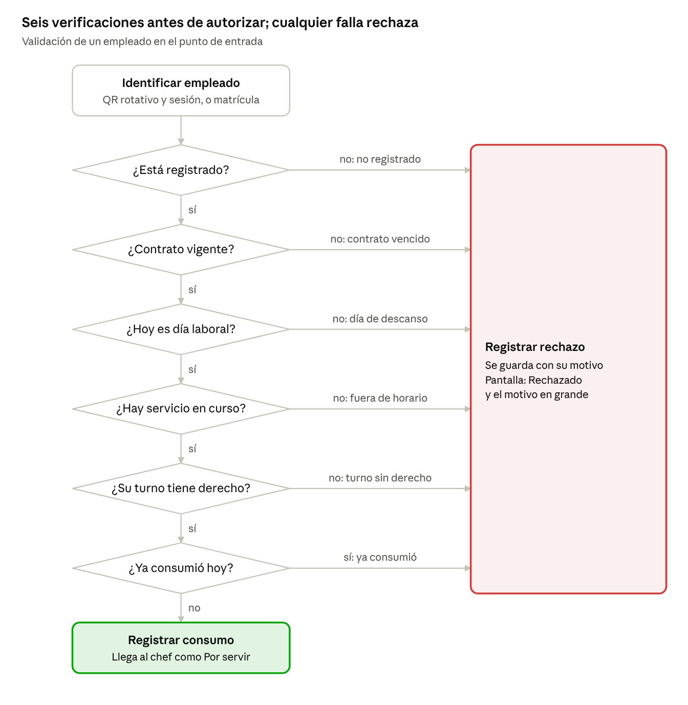
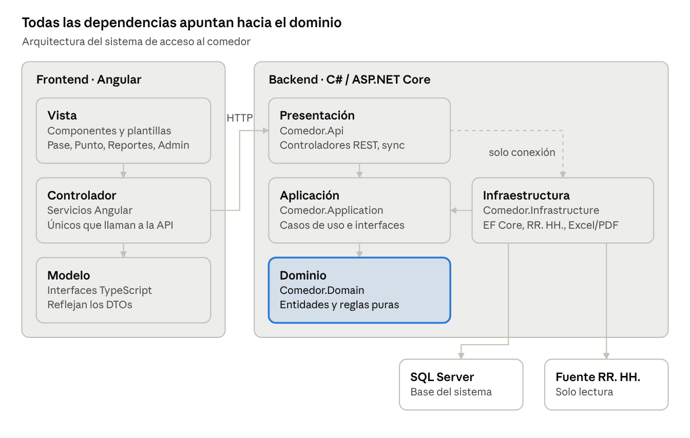

# Comedor de personal · Control de acceso y consumo

Sistema para controlar el acceso al comedor de personal: valida en tiempo real si cada empleado tiene derecho al tiempo de comida en curso según su turno, impide consumos repetidos y conserva un registro inalterable que sirve para cotejar la factura del proveedor.

> **Estado:** en implementación. La Tarea 1 dejó la estructura del monorepo; el avance sigue el [plan](docs/plan.md).

## Cómo funciona

1. La pantalla de la entrada, donde el chef sirve la comida, muestra un **código QR que cambia cada 30 segundos**.
2. El empleado lo escanea con la cámara de su celular e inicia sesión una sola vez con su ID y contraseña de la empresa.
3. El sistema aplica **seis verificaciones**: registrado, contrato vigente, día laboral, servicio en curso, turno con derecho y que no haya comido ya.
4. El celular muestra un pase **Autorizado** o **Rechazado** con el motivo. La solicitud aparece al instante en la **pantalla del chef**, con foto y nombre.
5. El chef entrega la comida y presiona **Servido**. No aprueba ni rechaza: el sistema decide.

Quien no tenga celular puede identificarse con su matrícula ante el chef, que la captura en la misma pantalla.



## Documentación

| Documento | Contenido |
| --- | --- |
| [Especificación de requisitos (SRS)](docs/srs.md) | Alcance, usuarios, requisitos funcionales y no funcionales, arquitectura, modelo de datos, errores, criterios de aceptación y pendientes con el cliente. |
| [Plan de implementación](docs/plan.md) | 16 tareas con desarrollo guiado por pruebas: archivos, interfaces, pruebas y comandos de cada una. |
| [Guía de diseño](docs/diseno.md) | Principios, colores, tipografía, componentes, pantallas de referencia y reglas de accesibilidad del frontend. |
| [Registro de decisiones](docs/decisiones.md) | Decisiones de arquitectura y de negocio, con su motivo y alternativas descartadas. |
| [Carga y aceptación](docs/aceptacion.md) | Resultado de la prueba de carga (RNF-01, RNF-02) y del recorrido de los criterios de aceptación, con lo pendiente en el entorno del cliente. |

## Arquitectura



| Componente | Tecnología |
| --- | --- |
| Backend | C# · ASP.NET Core sobre .NET 8 LTS, arquitectura por capas (Dominio, Aplicación, Infraestructura, API) |
| Frontend | Angular con NgModules, separación modelo-vista-controlador; interfaz según la [guía de diseño](docs/diseno.md) |
| Base de datos | SQL Server con Entity Framework Core 8 |
| Pruebas | xUnit, Moq, Testcontainers (SQL Server), Jasmine y Karma, k6 |
| Reportes | ClosedXML (Excel) y QuestPDF (PDF) |
| Instalación | On-premise en la red del cliente |

La fuente de RR. HH. y el autenticador de la empresa se integran mediante interfaces. En la v1 usan adaptadores simulados; los reales se agregan cuando informática confirme el acceso.

## Estructura del repositorio

```text
backend/            Solución .NET (Comedor.sln), proyectos por capa y pruebas
frontend/           Aplicación Angular (comedor-web)
load/               Prueba de carga con k6
docs/               SRS, plan, decisiones e imágenes
```

Las carpetas `backend/` y `frontend/` se crearon en la Tarea 1; `load/` se crea en la Tarea 15 del plan.

## Requisitos de desarrollo

| Herramienta | Versión |
| --- | --- |
| .NET SDK | 8.0 LTS |
| Node.js | 22 LTS |
| Angular CLI | 22.2.5 (Angular 22.2.4, Karma y Jasmine) |
| Docker | Necesario para las pruebas de integración con SQL Server |
| Git | 2.40 o superior |

## Desarrollo

El plan está escrito para ejecutarse tarea por tarea con [Claude Code](https://claude.com/claude-code). Desde la raíz del repositorio:

```text
Lee docs/srs.md y docs/plan.md y ejecuta el plan con subagent-driven-development, empezando por la Tarea 1.
```

Cada tarea sigue el mismo ciclo: escribir la prueba, comprobar que falla, implementar, comprobar que pasa y hacer commit. Las reglas del proyecto para quien programe están en [CLAUDE.md](CLAUDE.md).

### Configuración local

Los secretos no se guardan en el repositorio. La API se niega a iniciar (con un error que nombra la clave) si faltan `Jwt:Clave`, `Qr:ClaveFirma` o `ConnectionStrings:Comedor`. Desde `backend/src/Comedor.Api`:

```bash
dotnet user-secrets set "Jwt:Clave" "<mínimo 32 caracteres>"
dotnet user-secrets set "Qr:ClaveFirma" "<mínimo 32 caracteres>"
dotnet user-secrets set "ConnectionStrings:Comedor" "Server=localhost;Database=Comedor;Trusted_Connection=True;TrustServerCertificate=True"
# Administrador inicial: solo se siembra si no hay usuarios
dotnet user-secrets set "Semilla:Admin:Usuario" "<usuario>"
dotnet user-secrets set "Semilla:Admin:Contrasena" "<contraseña>"
```

En producción se usan variables de entorno equivalentes (`Jwt__Clave`, `Qr__ClaveFirma`, `ConnectionStrings__Comedor`, `Semilla__Admin__Usuario`, `Semilla__Admin__Contrasena`). Al iniciar, la API aplica las migraciones.

Para levantar el sistema: la API con `dotnet run --launch-profile http` desde `backend/src/Comedor.Api` (puerto 5277) y el frontend con `npx ng serve` desde `frontend/comedor-web` (puerto 4200). En desarrollo, el autenticador simulado solo tiene los empleados `E1001` y `E1002` (contraseñas en `appsettings.Development.json`). Para agregar otro empleado de prueba sin tocar el repositorio, hay que apuntar `Fuente:RutaEmpleados` a una copia del archivo simulado (ruta absoluta) y definir `Autenticacion:Simulada:Usuarios:<MATRÍCULA>` con user-secrets.

### Probar desde un celular en la red local

El QR apunta a `App:UrlPublica` y el frontend llama a la API en `apiUrl` (`frontend/comedor-web/src/environments/environment.ts`); ambos valen `localhost` por defecto, que el celular no alcanza. Para probar con un celular en la misma red, con `<IP>` como la IP de la PC:

1. `dotnet user-secrets set "App:UrlPublica" "http://<IP>:4200"` y `dotnet user-secrets set "Cors:Origenes:1" "http://<IP>:4200"`.
2. Cambiar `apiUrl` a `http://<IP>:5277` solo en la copia local; no se hace commit de ese cambio.
3. Levantar la API con `ASPNETCORE_URLS=http://0.0.0.0:5277` y `dotnet run --no-launch-profile` (con `ASPNETCORE_ENVIRONMENT=Development`), y el frontend con `npx ng serve --host 0.0.0.0`.
4. Permitir los puertos 4200 y 5277 en el firewall de Windows (PowerShell como administrador): `New-NetFirewallRule -DisplayName "Comedor (prueba local)" -Direction Inbound -Protocol TCP -LocalPort 4200,5277 -RemoteAddress LocalSubnet -Action Allow -Profile Any`. Al terminar, se quita con `Remove-NetFirewallRule -DisplayName "Comedor (prueba local)"`.
5. Volver a mostrar el QR desde Administración → Puntos → "Imprimir QR", porque el anterior apuntaba a `localhost`.

Al terminar, se quitan los dos secretos del paso 1 y se revierte `environment.ts`.

### Pruebas

`dotnet test backend/Comedor.sln` necesita Docker en ejecución: las pruebas de API levantan SQL Server con Testcontainers. La prueba de carga y el resultado de la aceptación están en [docs/aceptacion.md](docs/aceptacion.md).

### Convenciones

- **Idioma:** código de dominio, textos de interfaz y documentación en español.
- **Commits:** pequeños y con prefijo: `feat:`, `fix:`, `test:`, `chore:`, `docs:`.
- **Ramas:** `main` siempre estable; el trabajo se hace en ramas `tarea/<número>-<nombre>`.
- **Cambios de alcance:** primero se actualiza el SRS, luego el plan y al final el código.

## Pendientes con el cliente

Las decisiones abiertas, como el sistema de autenticación de la empresa, el formato del rol de descansos, la Wi-Fi para celulares y el certificado HTTPS, están en la [sección 11 del SRS](docs/srs.md#11-pendientes-por-confirmar-con-el-cliente).

## Licencia

Software propietario. Todos los derechos reservados. Uso restringido al proyecto y al cliente.
