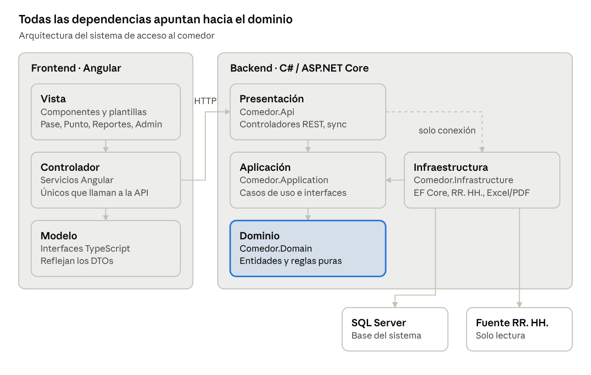
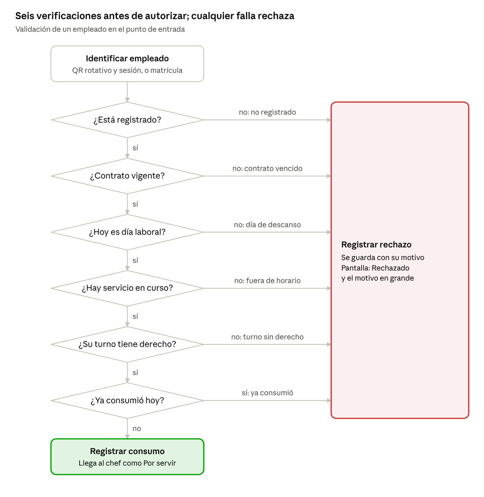

# Especificación de Requisitos de Software (SRS)

## Sistema de control de acceso y consumo del comedor de personal

| Campo | Valor |
| --- | --- |
| Versión | 1.1 |
| Fecha | 4 de noviembre de 2026 |
| Estado | Borrador para revisión con el cliente |
| Alcance | Subproyecto 1 de la plataforma del comedor |
| Documentos asociados | [Plan de implementación](plan.md) · [Guía de diseño](diseno.md) · [Decisiones](decisiones.md) |
| Fuente editable | Documento colaborativo en Claude (este archivo es una exportación) |

| Versión | Cambios |
| --- | --- |
| 1.0 | Versión inicial aprobada para planeación. |
| 1.1 | Un solo punto de entrada, donde el chef sirve la comida. Referencia a la guía de diseño. |

## 1. Introducción

### 1.1 Propósito

Este documento especifica los requisitos del sistema de control de acceso y consumo del comedor de personal. Es la base acordada para el diseño, la implementación y las pruebas, y sirve como plan del proyecto.

### 1.2 Alcance

El sistema identifica a cada empleado al llegar al comedor, valida si tiene derecho al tiempo de comida en curso según su turno, impide consumos repetidos y conserva un registro inalterable. Ese registro es la base para validar la factura del proveedor del comedor y para el control interno.

Este es el **subproyecto 1** de una plataforma mayor. Menús, inventarios, compras, costos, inocuidad y personal de cocina quedan fuera (sección 10).

### 1.3 Definiciones

| Término          | Significado                                                                                                                    |
|------------------|--------------------------------------------------------------------------------------------------------------------------------|
| Empleado         | Persona del personal con matrícula en la base de RR. HH. del cliente.                                                          |
| Turno            | Jornada fija asignada al empleado durante la vigencia de su contrato (por ejemplo, matutino).                                  |
| Tiempo de comida | Servicio con horario definido: desayuno, comida, cena o colación.                                                              |
| Regla de derecho | Relación configurable turno → tiempos de comida → horario.                                                                     |
| Consumo          | Registro de que un empleado recibió un tiempo de comida.                                                                       |
| Rechazo          | Intento de acceso denegado, con su motivo.                                                                                     |
| Punto de entrada | Pantalla en la entrada que muestra el QR rotativo y permite al encargado la captura manual.                                    |
| Encargado        | Chef o encargado de la entrega: ve en la pantalla del punto cada solicitud autorizada, marca Servido y hace capturas manuales. |
| Fuente RR. HH.   | Base de datos existente del cliente con empleados, turnos y contratos.                                                         |

## 2. Descripción general

### 2.1 Perspectiva del producto

Es un sistema nuevo e independiente que corre en un servidor dentro de la red del cliente. Lee la fuente de RR. HH. en modo solo lectura; no la modifica.

### 2.2 Usuarios del sistema

| Rol                 | Qué hace                                                                                                                                                                                                                |
|---------------------|-------------------------------------------------------------------------------------------------------------------------------------------------------------------------------------------------------------------------|
| Empleado (comensal) | Escanea con la cámara de su celular el QR rotativo de la entrada e inicia sesión con su ID y contraseña de la empresa; su solicitud llega a la pantalla del chef.                                                       |
| Encargado (chef)    | Ve en la pantalla del punto cada solicitud con foto, nombre y resultado; entrega la comida a los autorizados y marca Servido. No aprueba ni rechaza: el sistema decide. Captura la matrícula de quien no tenga celular. |
| Punto (pantalla)    | Sesión de la pantalla de la entrada: muestra el QR rotativo y la lista de solicitudes; sesión de 30 días.                                                                                                               |
| Supervisor          | Consulta reportes y rechazos; revisa el estado de la sincronización.                                                                                                                                                    |
| Administrador       | Configura reglas de derecho, puntos de entrada y usuarios del sistema.                                                                                                                                                  |

### 2.3 Escala de operación

Un comedor con un solo punto de entrada, donde el chef sirve la comida, y de 300 a 1,000 comidas por servicio. El modelo de datos admite agregar puntos en el futuro sin cambiar el diseño.

### 2.4 Restricciones

- Frontend en Angular (versión actual, con NgModules), organizado en modelo, vista y controlador (sección 5); la vista del empleado es adaptada a celular.

- Backend en C# con ASP.NET Core sobre .NET 8 LTS y arquitectura por capas (sección 5).

- Base de datos SQL Server, sujeta a lo que acepte informática del cliente.

- Instalación on-premise en la red del cliente, sin depender de internet; los celulares se conectan a la red interna (Wi-Fi del comedor).

- Entrada en autoservicio desde el celular, con un encargado que verifica el pase.

### 2.5 Supuestos

- El turno de cada empleado es fijo durante la vigencia de su contrato.

- Cada empleado tiene derecho a una comida por cada tiempo que le corresponde según su turno.

- El turno nocturno puede tener tiempos de comida a la mañana siguiente (por ejemplo, desayuno al salir) y horarios que crucen la medianoche; el consumo se asigna a la **fecha de servicio**, el día en que inicia ese horario.

- La comida es una prestación: no hay cobro ni caja.

- Los empleados inician sesión con el ID y la contraseña de la empresa; el sistema que los valida está por definir.

- La mayoría de los empleados tiene celular con cámara y navegador.

### 2.6 Dependencias

- Acceso de lectura a la fuente RR. HH.: empleados, turnos (Matutino, Vespertino, Nocturno), rol de días laborales y descansos, y contratos. En desarrollo, adaptador simulado.

- Servicio de autenticación de la empresa para validar ID y contraseña (por definir; en desarrollo, adaptador simulado). Si informática no permite usar la contraseña corporativa, la alternativa es su sistema de huella (sección 10).

- **Crítica:** Wi-Fi en el comedor accesible desde celulares personales y con ruta al servidor del comedor; informática debe validarla antes de construir el módulo Pase. En desarrollo se simula en red local.

- **Crítica:** certificado HTTPS emitido por una autoridad reconocida por los celulares (por ejemplo, para comedor.\<dominio-del-cliente\> apuntando a la IP interna), gestionado por informática.

- Servidor y red interna provistos por el cliente.

- Una pantalla o tablet en la entrada, a la vista del chef, para el QR rotativo, la lista de solicitudes y la captura manual.

### 2.7 Riesgos aceptados

- **Uso de la cuenta de otro empleado:** si alguien inicia sesión con credenciales ajenas, la comida se descuenta al titular y el total no aumenta; la factura sigue correspondiendo a comidas servidas. El encargado detecta solo casos evidentes.

## 3. Requisitos funcionales

Prioridad: **Alta** = indispensable para la v1; **Media** = deseable en la v1.

| ID                             | Requisito                                                                                                                                                                                                                                                                                                        | Prioridad |
|--------------------------------|------------------------------------------------------------------------------------------------------------------------------------------------------------------------------------------------------------------------------------------------------------------------------------------------------------------|-----------|
| **Sincronización de personal** |                                                                                                                                                                                                                                                                                                                  |           |
| RF-01                          | El sistema importa de la fuente RR. HH. matrícula, nombre, foto (si existe), área, turno, rol de días laborales y descansos, e inicio y fin de contrato.                                                                                                                                                         | Alta      |
| RF-02                          | La sincronización corre automáticamente cada noche y puede lanzarse bajo demanda por un administrador.                                                                                                                                                                                                           | Alta      |
| RF-03                          | El sistema nunca escribe en la fuente RR. HH.                                                                                                                                                                                                                                                                    | Alta      |
| RF-04                          | Cada sincronización queda registrada: fecha, resultado y empleados agregados, modificados y dados de baja.                                                                                                                                                                                                       | Media     |
| **Reglas de derecho**          |                                                                                                                                                                                                                                                                                                                  |           |
| RF-05                          | El administrador configura qué tiempos de comida corresponden a cada turno y su horario (inicio y fin). Un horario puede cruzar la medianoche (fin menor que inicio).                                                                                                                                            | Alta      |
| RF-06                          | La fecha de servicio es el día en que inició la jornada a la que pertenece la comida: el día en que inicia el horario, o el día anterior si la regla está marcada "pertenece a la jornada del día anterior" (por ejemplo, el desayuno del turno nocturno al salir). El contrato debe estar vigente en esa fecha. | Alta      |
| RF-27                          | Un empleado no tiene derecho si la fecha de servicio es día de descanso según su rol sincronizado; motivo "Hoy es tu día de descanso".                                                                                                                                                                           | Alta      |
| RF-28                          | El sistema impide guardar dos reglas del mismo turno con horarios traslapados.                                                                                                                                                                                                                                   | Alta      |
| **Entrada desde el celular**   |                                                                                                                                                                                                                                                                                                                  |           |
| RF-07                          | Cada punto de entrada muestra en pantalla un QR que cambia cada 30 segundos y contiene un token firmado con el punto y la hora de emisión.                                                                                                                                                                       | Alta      |
| RF-08                          | El empleado escanea el QR con la cámara de su celular; el QR abre la aplicación web con el token.                                                                                                                                                                                                                | Alta      |
| RF-09                          | El empleado inicia sesión con su ID y contraseña de la empresa; la sesión se recuerda en el celular durante 30 días (configurable).                                                                                                                                                                              | Alta      |
| RF-10                          | El servidor acepta un token de QR solo durante 60 segundos desde su emisión. Un token vencido no genera rechazo: el celular pide escanear de nuevo.                                                                                                                                                              | Alta      |
| RF-11                          | El celular muestra un pase a pantalla completa: Autorizado o Rechazado, foto, nombre, turno, tiempo de comida, hora, y una animación continua que distingue el pase vivo de una captura de pantalla.                                                                                                             | Alta      |
| RF-12                          | Un rechazo muestra su motivo: no registrado, contrato vencido, día de descanso, fuera de horario, turno sin derecho a este tiempo o ya consumió.                                                                                                                                                                 | Alta      |
| RF-13                          | El rechazo es definitivo; no hay excepciones manuales en la v1.                                                                                                                                                                                                                                                  | Alta      |
| RF-14                          | Un empleado puede consumir solo una vez por tiempo de comida y fecha de servicio, sin importar el canal (celular, manual o contingencia).                                                                                                                                                                        | Alta      |
| RF-15                          | El chef puede capturar la matrícula de un empleado sin celular en la pantalla del punto; aplica las mismas verificaciones.                                                                                                                                                                                       | Alta      |
| RF-16                          | La identificación es independiente de la validación, de modo que se puedan agregar otros métodos (por ejemplo, huella) sin cambiar las reglas.                                                                                                                                                                   | Alta      |
| RF-31                          | Etapa de registro previo: un enlace permite iniciar sesión y dejar el celular listo antes del arranque, sin registrar consumo.                                                                                                                                                                                   | Media     |
| **Pantalla del chef**          |                                                                                                                                                                                                                                                                                                                  |           |
| RF-29                          | La pantalla del punto muestra en tiempo real cada solicitud de ese punto: foto, nombre, turno, tiempo de comida y Autorizado o Rechazado con su motivo. Los autorizados quedan en la lista "Por servir".                                                                                                         | Alta      |
| RF-30                          | El chef marca Servido sobre un autorizado; no puede aprobar ni rechazar. Un consumo se sirve una sola vez.                                                                                                                                                                                                       | Alta      |
| **Registro de consumos**       |                                                                                                                                                                                                                                                                                                                  |           |
| RF-17                          | Cada consumo autorizado guarda empleado, fecha de servicio, tiempo de comida, fecha y hora exacta, punto de entrada, canal (celular, manual o contingencia) y el encargado cuando aplica.                                                                                                                        | Alta      |
| RF-18                          | Cada rechazo se guarda con los mismos datos y su motivo.                                                                                                                                                                                                                                                         | Alta      |
| RF-32                          | Cada Servido se guarda como una entrega (consumo, fecha y hora, chef), de solo inserción.                                                                                                                                                                                                                        | Alta      |
| RF-19                          | Ningún consumo, rechazo ni entrega puede editarse o borrarse por ningún rol.                                                                                                                                                                                                                                     | Alta      |
| **Reportes**                   |                                                                                                                                                                                                                                                                                                                  |           |
| RF-20                          | Conteo de consumos por fecha de servicio, tiempo de comida, turno y área, en un rango de fechas.                                                                                                                                                                                                                 | Alta      |
| RF-21                          | Reporte para cotejar la factura del proveedor: comidas **servidas** por fecha de servicio y tiempo de comida en el periodo facturado, y aparte las autorizadas sin servir.                                                                                                                                       | Alta      |
| RF-22                          | Detalle de consumos y rechazos filtrable por empleado, fecha, punto, canal y motivo.                                                                                                                                                                                                                             | Media     |
| RF-23                          | Exportación de reportes a Excel y PDF.                                                                                                                                                                                                                                                                           | Alta      |
| **Administración y seguridad** |                                                                                                                                                                                                                                                                                                                  |           |
| RF-24                          | Los usuarios del sistema (punto, encargado, supervisor, administrador) inician sesión con usuario y contraseña propios; acceso por rol con JWT. Sesión de 12 horas, salvo el rol Punto: 30 días.                                                                                                                 | Alta      |
| RF-25                          | Alta, baja y edición de puntos de entrada y usuarios del sistema.                                                                                                                                                                                                                                                | Alta      |

## 4. Requisitos no funcionales

| ID     | Categoría      | Requisito                                                                                                                                                                          |
|--------|----------------|------------------------------------------------------------------------------------------------------------------------------------------------------------------------------------|
| RNF-01 | Rendimiento    | Con sesión ya iniciada, el pase aparece en menos de 2 segundos desde que se escanea el QR; la captura manual responde en menos de 1 segundo.                                       |
| RNF-02 | Capacidad      | Soporta en su punto de entrada 1,000 consumos por servicio, con picos de 50 validaciones por minuto, sin degradarse.                                                               |
| RNF-03 | Integridad     | Dos validaciones simultáneas del mismo empleado producen un solo consumo (restricción única en base de datos sobre matrícula, fecha de servicio y tiempo de comida).               |
| RNF-04 | Auditoría      | Los registros de consumo, entrega y rechazo son de solo inserción; ningún endpoint ni rol los modifica.                                                                            |
| RNF-05 | Disponibilidad | Si la fuente RR. HH. no responde, el sistema sigue validando con la última copia sincronizada y muestra un aviso.                                                                  |
| RNF-06 | Seguridad      | Tokens de QR firmados con HMAC-SHA256 y clave del servidor; contraseñas de usuarios del sistema con hash; HTTPS dentro de la red; las credenciales de la empresa nunca se guardan. |
| RNF-07 | Respaldo       | Respaldo automático diario de la base de datos del sistema.                                                                                                                        |
| RNF-08 | Usabilidad     | El pase se distingue a 2 metros por color (verde o rojo) y texto grande; la captura manual se opera con la matrícula y Enter.                                                      |
| RNF-09 | Compatibilidad | Celular: Chrome en Android y Safari en iOS actuales. Pantallas de punto y administración: Chrome y Edge actuales.                                                                  |
| RNF-10 | Mantenibilidad | Arquitectura por capas en el backend y separación modelo-vista-controlador en el frontend (sección 5); reglas de dominio cubiertas por pruebas unitarias.                          |
| RNF-11 | Portabilidad   | Instalable en servidor Windows o Linux.                                                                                                                                            |

## 5. Arquitectura

Un servidor web on-premise expone una API REST en C#; los celulares y las pantallas de los puntos usan una aplicación Angular en el navegador. Las reglas de negocio viven en el dominio y no dependen de frameworks ni de la base de datos.

arquitectura · frontend MVC y backend por capas

Infraestructura implementa las interfaces que define Aplicación; la API solo la conecta al arrancar (línea punteada).

### 5.1 Backend en C#: arquitectura por capas

| Capa            | Proyecto               | Contenido                                                                                                                                                                                                                                                                                                | Depende de                                      |
|-----------------|------------------------|----------------------------------------------------------------------------------------------------------------------------------------------------------------------------------------------------------------------------------------------------------------------------------------------------------|-------------------------------------------------|
| Dominio         | Comedor.Domain         | Entidades (Empleado, Turno, TiempoComida, ReglaDerecho, Consumo, Rechazo, Entrega, PuntoEntrada), reglas puras ("¿tiene derecho?", "¿ya comió?", fecha de servicio) y motivos de rechazo.                                                                                                                | Nada                                            |
| Aplicación      | Comedor.Application    | Casos de uso: EmitirTokenQr, ValidarAcceso, ListarSolicitudes, MarcarServido, IniciarSesionEmpleado, SincronizarPersonal, GenerarReporte, AdministrarReglas. Interfaces (IEmpleadoRepositorio, IConsumoRepositorio, IFuentePersonalRRHH, IAutenticadorEmpresa, IFirmaToken, IReloj, IExportador) y DTOs. | Dominio                                         |
| Infraestructura | Comedor.Infrastructure | EF Core sobre SQL Server, repositorios, adaptadores de la fuente RR. HH. y del autenticador de la empresa (simulados en la v1), firma HMAC de tokens, exportación a Excel (ClosedXML) y PDF (QuestPDF).                                                                                                  | Aplicación                                      |
| Presentación    | Comedor.Api            | Controladores REST, autenticación JWT por roles, tarea programada de sincronización, registro de dependencias.                                                                                                                                                                                           | Aplicación (Infraestructura solo para conectar) |

Un proyecto de pruebas por capa: Comedor.Domain.Tests, Comedor.Application.Tests y Comedor.Api.Tests (integración).

### 5.2 Frontend en Angular: modelo, vista y controlador

Angular se basa en componentes; la separación MVC se aplica así:

- **Modelo:** interfaces TypeScript (empleado.model.ts, pase.model.ts, consumo.model.ts) que reflejan los DTOs de la API.

- **Vista:** componentes y plantillas que solo muestran datos y capturan eventos.

- **Controlador:** servicios Angular (pase.service.ts, punto.service.ts, reportes.service.ts, admin.service.ts, auth.service.ts) con la lógica de pantalla; son los únicos que llaman a la API.

Cuatro módulos funcionales: **Pase** (celular del empleado: inicio de sesión y pase), **Punto** (pantalla del chef: QR rotativo, solicitudes por servir y captura manual), **Reportes** y **Administración**, más un módulo compartido de autenticación. La interfaz sigue la guía de diseño del repositorio ([docs/diseno.md](diseno.md)): estilo institucional sencillo, tipografía Montserrat, verde institucional con acento dorado, sin logotipos oficiales hasta que el cliente los proporcione.

### 5.3 Base de datos

SQL Server, natural con .NET y probable en la infraestructura del cliente. Si informática exige otro motor, EF Core permite cambiarlo tocando solo Infraestructura.

## 6. Flujo de validación en la entrada

Antes de las verificaciones, el servidor confirma que el token del QR es auténtico y tiene menos de 60 segundos (RF-10); si no, el celular pide escanear de nuevo y no se registra rechazo. En la captura manual este paso no aplica. Después, cada intento pasa por seis verificaciones en orden; la primera que falla define el motivo del rechazo. Todo resultado aparece al instante en la pantalla del chef; los autorizados quedan en "Por servir" hasta que el chef marca Servido.

flujo de validación · 6 verificaciones

La verificación "¿ya consumió?" y el registro del consumo ocurren en una sola transacción con restricción única (empleado, fecha, tiempo de comida), de modo que dos intentos simultáneos (por ejemplo, celular y captura manual) no pueden registrar a la misma persona dos veces (RNF-03).

**Secuencia técnica (celular):** la pantalla del punto pide GET /api/puntos/{id}/qr cada 30 s y dibuja el QR con la URL /pase?t=\<token\> → el celular abre esa URL; si no hay sesión, auth.service.ts llama POST /api/empleados/sesion (valida con IAutenticadorEmpresa y devuelve un JWT de empleado) → pase.service.ts llama POST /api/accesos/celular con el token → ValidarAcceso verifica el token, aplica las reglas y guarda el consumo o el rechazo → el celular muestra el pase.

**Secuencia técnica (manual):** el encargado teclea la matrícula en el punto → punto.service.ts llama POST /api/accesos/manual con JWT de encargado → mismo caso de uso, canal manual → el resultado aparece en la pantalla del punto.

## 7. Modelo de datos

Ocho entidades cubren la v1; Consumo, Entrega y Rechazo son de solo inserción.

| Entidad      | Campos principales                                                                                                                                             | Notas                                                                                                                                  |
|--------------|----------------------------------------------------------------------------------------------------------------------------------------------------------------|----------------------------------------------------------------------------------------------------------------------------------------|
| Empleado     | Matrícula (clave), nombre, foto, área, turno, días laborales (conjunto de días de la semana), inicio y fin de contrato, fecha de última sincronización, activo | Copia de la fuente RR. HH.; solo la modifica la sincronización. El formato real del rol de descansos se ajusta al confirmar la fuente. |
| Turno        | Clave, nombre (Matutino, Vespertino, Nocturno)                                                                                                                 | Catálogo; se alinea con los valores de la fuente RR. HH.                                                                               |
| TiempoComida | Clave, nombre (Desayuno, Comida, Cena, Colación)                                                                                                               | Catálogo.                                                                                                                              |
| ReglaDerecho | Turno, tiempo de comida, hora de inicio, hora de fin, pertenece a la jornada del día anterior (sí/no)                                                          | Configurable. Fin menor que inicio = cruza la medianoche. Sin traslapes dentro de un turno.                                            |
| PuntoEntrada | Clave, nombre, activo                                                                                                                                          | Una pantalla de QR y solicitudes por punto.                                                                                            |
| Consumo      | Id, matrícula, fecha de servicio, tiempo de comida, fecha y hora exacta, punto de entrada, canal (Celular, Manual, Contingencia), encargado (si aplica)        | Restricción única (matrícula, fecha de servicio, tiempo de comida). Sin actualización ni borrado.                                      |
| Entrega      | Id, consumo (único), fecha y hora, chef                                                                                                                        | Una por consumo. Sin actualización ni borrado.                                                                                         |
| Rechazo      | Id, matrícula, fecha y hora, fecha de servicio y tiempo de comida (si aplican), punto de entrada, canal, encargado (si aplica), motivo                         | Sin actualización ni borrado.                                                                                                          |

Tablas de apoyo: UsuarioSistema (usuario, hash de contraseña, rol, activo) y BitacoraSincronizacion (fecha, resultado, altas, cambios, bajas, error).

## 8. Manejo de errores y contingencia

Ningún error puede producir un consumo duplicado ni perder uno registrado.

| Situación                                                                               | Comportamiento del sistema                                                                                                                         |
|-----------------------------------------------------------------------------------------|----------------------------------------------------------------------------------------------------------------------------------------------------|
| La fuente RR. HH. no responde durante la sincronización                                 | Se conserva la última copia; se registra el error en la bitácora y se muestra un aviso al supervisor y al administrador.                           |
| La sincronización trae datos inválidos (matrícula vacía, turno desconocido)             | Se omite ese registro, se anota en la bitácora y la sincronización continúa con los demás.                                                         |
| Dos intentos simultáneos del mismo empleado (dos celulares, o celular y captura manual) | La restricción única permite solo un consumo; el segundo recibe "Rechazado: ya consumió".                                                          |
| Token de QR vencido, alterado o de un punto inactivo                                    | El celular muestra "Escanea de nuevo el código de la entrada"; no se registra rechazo.                                                             |
| ID o contraseña de la empresa incorrectos                                               | El celular muestra "Credenciales incorrectas"; tras 5 intentos fallidos en 15 minutos se bloquea ese ID por 15 minutos.                            |
| El servicio de autenticación de la empresa no responde                                  | El celular muestra "No se pudo verificar tu cuenta; acude con el encargado" y el chef usa la captura manual.                                       |
| Empleado sin celular, sin batería o sin Wi-Fi                                           | El chef captura su matrícula en el punto (RF-15).                                                                                                  |
| El chef presiona Servido dos veces seguidas                                             | La entrega es única por consumo; el segundo clic no crea otra y la pantalla lo muestra como ya servido.                                            |
| Un autorizado nunca recoge su comida                                                    | Queda en "Por servir" hasta el fin del horario; luego sale de la lista y aparece en el reporte como autorizado sin servir.                         |
| La pantalla del punto pierde conexión                                                   | Deja de mostrar QR y muestra "Sin conexión"; un QR que no se renueva caduca solo a los 60 segundos. Al reconectar, recupera la lista "Por servir". |
| El servidor no está disponible                                                          | Procedimiento de contingencia: lista en papel firmada por el chef, capturada después por un administrador como consumos de canal Contingencia.     |
| Error inesperado en la API                                                              | Se registra en bitácora técnica con fecha, endpoint y detalle; el usuario ve un mensaje genérico.                                                  |

La captura de contingencia agrega un requisito: **RF-26 (Media)** registrar consumos de canal Contingencia con autor y referencia a la lista en papel, sujetos a la misma restricción única.

## 9. Pruebas y criterios de aceptación

### 9.1 Estrategia de pruebas

| Nivel                   | Qué cubre                                                                                              | Herramienta                   |
|-------------------------|--------------------------------------------------------------------------------------------------------|-------------------------------|
| Unitarias de dominio    | Cada regla de derecho y cada motivo de rechazo, incluidos límites de horario y de vigencia de contrato | xUnit                         |
| Unitarias de aplicación | Casos de uso con repositorios simulados                                                                | xUnit + Moq                   |
| Integración             | API + SQL Server real: restricción única, inmutabilidad de consumos, sincronización                    | xUnit + WebApplicationFactory |
| Frontend                | Servicios y componentes de la pantalla de entrada                                                      | Jasmine/Karma o Jest          |
| Carga                   | Un punto con 1,000 validaciones por servicio y picos de 50 por minuto                                  | k6 o JMeter                   |

### 9.2 Criterios de aceptación

- [ ] Un empleado vigente, en día laboral, en su turno y dentro del horario ve el pase Autorizado en su celular en menos de 2 segundos tras escanear, con sesión ya iniciada.

- [ ] La misma solicitud aparece en la pantalla del chef en menos de 3 segundos, con foto y nombre, en la lista "Por servir".

- [ ] Al marcar Servido, sale de la lista y queda una entrega registrada; un segundo clic no crea otra.

- [ ] Un QR fotografiado y escaneado más de 60 segundos después es rechazado con "Escanea de nuevo".

- [ ] Cada uno de los seis motivos de rechazo aparece en el pase cuando corresponde.

- [ ] Un segundo intento del mismo empleado en el mismo tiempo de comida, por cualquier canal, es rechazado.

- [ ] Dos validaciones simultáneas del mismo empleado producen un solo consumo.

- [ ] Un empleado del turno nocturno puede desayunar al salir y su consumo queda en la fecha de la jornada que trabajó, aunque el día siguiente sea su descanso.

- [ ] La captura manual del chef aplica las mismas reglas que el celular.

- [ ] Ningún rol puede editar ni borrar consumos, entregas o rechazos.

- [ ] Un empleado con contrato vencido en la fuente RR. HH. pierde el derecho tras la siguiente sincronización.

- [ ] Con la fuente RR. HH. caída, el sistema sigue validando y muestra el aviso.

- [ ] El reporte de cotejo cuenta solo comidas servidas, separa las autorizadas sin servir, y se exporta a Excel y PDF.

- [ ] La prueba de carga cumple RNF-01 y RNF-02.

## 10. Fuera de alcance y subproyectos futuros

La v1 excluye explícitamente:

- Excepciones manuales al rechazo y registro de visitantes o personal externo.

- Conexión real con la fuente RR. HH. y con el autenticador de la empresa: en la v1 se usan adaptadores simulados detrás de sus interfaces, y los reales se agregan al confirmar con informática.

- Torniquetes o barreras físicas.

- Cobro, caja y facturación.

- Dietas hospitalarias y atención a pacientes.

- **v2:** aviso de privacidad en el primer inicio de sesión, con el texto que proporcione el cliente.

**Huella (v2):** el cliente ya tiene un sistema de identificación por huella sobre su base de empleados. Es la alternativa si informática no permite usar la contraseña corporativa, y la ruta para mayor seguridad después. Conviene reunirse con ellos para evaluar si puede usarse en la entrada. La arquitectura lo permite sin cambiar las reglas (RF-16).

Subproyectos posteriores de la plataforma, cada uno con su propio SRS:

1.  Planeación de menús y recetario.

2.  Inventarios y almacén (lotes, caducidades, PEPS).

3.  Compras y proveedores.

4.  Producción y costos por ración.

5.  Control sanitario e inocuidad (bitácoras de temperatura, limpieza, plagas).

6.  Control del personal de cocina.

7.  Tablero de indicadores y alertas integradas.

## 11. Pendientes por confirmar con el cliente

Estas decisiones pueden cambiar requisitos; cada una indica a cuáles afecta.

- [ ] Sistema contra el que se validan el ID y la contraseña de la empresa, y si informática lo permite (RF-09).

- [ ] Reunión sobre el sistema de huella existente y si puede reutilizarse (sección 10).

- [ ] Wi-Fi accesible desde celulares personales y certificado HTTPS (sección 2.6).

- [ ] Motor, tabla o vista y credenciales de solo lectura de la fuente RR. HH., incluido el formato del rol de descansos (RF-01 a RF-03, RF-27).

- [ ] Lista de turnos y horarios de cada tiempo de comida, cuáles pertenecen a la jornada del día anterior y cómo tratar horarios que se traslapen (RF-05, RF-06, RF-28).

- [ ] Formato y periodo de la factura del proveedor para el reporte de cotejo (RF-21).

- [ ] Aceptación de SQL Server, .NET 8 y del sistema operativo del servidor por parte de informática (sección 5.3).

- [ ] Disponibilidad de foto del empleado en la fuente RR. HH. (RF-11, RF-29).

- [ ] Licencia de QuestPDF: es gratuita para organizaciones con ingresos anuales menores a 1 millón de dólares; confirmar si aplica.

## Anexo A: Enfoques evaluados

Se evaluaron tres formas de construir el sistema; se eligió el enfoque 1.

| Enfoque                                           | Cómo funciona                                                                                                                                                  | A favor                                                                                                                                         | En contra                                                                                                                                            |
|---------------------------------------------------|----------------------------------------------------------------------------------------------------------------------------------------------------------------|-------------------------------------------------------------------------------------------------------------------------------------------------|------------------------------------------------------------------------------------------------------------------------------------------------------|
| 1\. Aplicación web central (recomendado)          | Un servidor en la red del cliente con base de datos y lógica; las tablets usan el navegador; un proceso programado sincroniza empleados y turnos desde RR. HH. | Lo más sencillo de construir, mantener y actualizar (una sola vez en el servidor). Evitar dobles registros es fácil con una sola base de datos. | Si el servidor o la red interna fallan, la entrada se detiene. Se mitiga con contingencia: lista en papel que se captura después.                    |
| 2\. Aplicación instalada por punto con base local | Cada tablet o PC tiene su copia de los datos y sincroniza con el servidor.                                                                                     | Sigue funcionando aunque se caiga la red.                                                                                                       | Mucho más compleja. Registros simultáneos sin conexión generan conflictos en el conteo para facturar. Varias aplicaciones que instalar y actualizar. |
| 3\. Adaptar software comercial                    | Comprar un producto de comedores o asistencia y configurarlo.                                                                                                  | Sale rápido.                                                                                                                                    | Rara vez se integra bien con una base de turnos propia; reportes de validación de factura limitados; dependencia del fabricante.                     |
